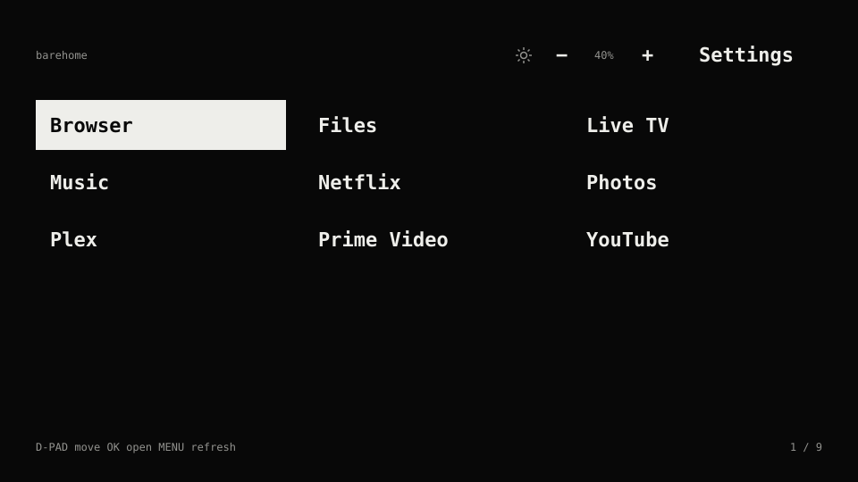

# BareHome

A tiny home screen for Android TV. Text, a remote, your apps.

**1.2 prerelease:** adds TV-confirmed mode reporting for BareRemote 0.3. Its new
reply path still awaits physical-TV testing. [Download the prerelease](https://github.com/nicolas-mvd/barehome/releases/tag/v1.2);
the latest stable release remains 1.1.

Inspired by the suckless approach: small code, few moving parts, configuration in
source. One visible Activity and Canvas View. Android's built-in Java APIs. No libraries,
Gradle, ads, recommendations, artwork, services, or idle polling. The optional
phone mode check sends one authenticated local-network reply per request.



*Illustration; installed apps vary.*

## Put it on my TV

Copy this into ChatGPT or a local coding agent:

> I found https://github.com/nicolas-mvd/barehome and want it on my TV. Read the
> README, AGENTS.md, docs/CONNECT.md, and docs/BRIGHTNESS.md. Help me connect my TV
> through wireless or USB debugging, install BareHome, test it, and make it my
> default launcher. Save my previous launcher so I can switch back. Enable the
> Day/Night picture controls if my TV supports them. Use local tools if you have access
> to my computer; otherwise guide me through the commands.

The connection runs through **ADB on your computer**. A normal ChatGPT web chat
can guide you, but cannot reach your home network by itself. A local agent such
as [Codex CLI](https://learn.chatgpt.com/docs/codex/cli) can run the commands when
given access to your computer. BareHome itself has no AI or account requirement.

[Download the latest APK](https://github.com/nicolas-mvd/barehome/releases/latest)
and follow [Connect and install](docs/CONNECT.md). AI assistants should start with
[AGENTS.md](AGENTS.md).

Already connected through ADB? From this repository on macOS or Linux:

```sh
export BAREHOME_TV='YOUR_ADB_SERIAL_OR_IP:PORT'
./tv.sh status
./tv.sh capture-home                         # Before installing a new Home app
./tv.sh install /path/to/BareHome.apk
./tv.sh run                                 # Check the screen and remote
./tv.sh use                                 # Make BareHome the default Home
./tv.sh backlight-permission                # Optional; supported TV only
```

To switch back: `./tv.sh restore`. Keep the original launcher installed.
The [full guide](docs/CONNECT.md) also has direct ADB commands for Windows.

## Use

**BareHome 1.2** has one **☀ Day / ☾ Night** button beside Settings. Click to
switch modes; hold OK to customize the selected mode.

| Control | Action |
| --- | --- |
| D-pad / OK | Select / open an app |
| Up from the first row | Select Settings |
| Left from Settings | Select Day/Night |
| Short OK on Day/Night | Apply the other mode's saved levels |
| Hold OK on Day/Night | Edit the selected mode's Backlight and Picture Brightness |
| Up / Down in the editor | Choose a setting, Save, or Cancel |
| Left / Right in the editor | Adjust the selected level by one point |
| Save / Cancel or Back | Apply and remember edits / discard edits |
| Down from the header | Return to the app grid |
| Home | Return to BareHome and the previous selection |
| Back on the home screen | Stay on the home screen |
| Menu | Refresh installed apps and picture-mode state |

Day and Night each remember **Backlight (5–100)** and **Picture Brightness
(0–100)**. Night starts at **5 / 20**; Day starts from the TV's existing levels.
The button shows the selected mode. Starting BareHome does not reapply a preset,
and there is no background service or polling. The [picture-controls guide](docs/BRIGHTNESS.md)
explains defaults, upgrades, and the difference between the two settings.

These controls use the manufacturer's actual panel-backlight and picture-signal
settings on the tested CSV4K. After installing, enable the optional permission
once with `./tv.sh backlight-permission`. The old `WRITE_SETTINGS` grant is
insufficient. Other TVs retain normal app launching, with picture controls
unavailable. There is no generic Android brightness fallback.

Version **1.2** lets [BareRemote](https://github.com/nicolas-mvd/bareremote)
check the selected preset and actual picture levels, then display one sun/moon
button. Tap that phone button to toggle using the TV's saved choice. Both phones
can request the current TV state without guessing from their own previous tap.
An idle phone widget retains its last confirmed state; Sync refreshes it.

The request arrives through the already paired Android TV Remote connection.
A tiny windowless entry point passes it to a short receiver, which sends one
authenticated UDP reply to the requesting phone on the local network. This
requires Android's `INTERNET` permission, but adds no TV network listener,
permanent service, cloud connection or polling. The same model, picture-mode,
automatic-lighting and permission checks apply. A query never writes TV picture
settings. Older explicit Day/Night links remain compatible.

Upgrade in place to retain profiles, permission and launcher data. See
[remote picture controls](docs/BRIGHTNESS.md#from-a-paired-phone) for the reply
protocol, network requirements and limits. A settings confirmation is not a
measurement of light output or a guarantee of uninterrupted playback.

BareRemote's source button uses `barehome://inputs` to open the TV's existing
input menu. BareHome dispatches `com.android.tv.action.VIEW_INPUTS` rather than
selecting an HDMI port automatically. The TV must provide an exported handler for
that action; otherwise a message reports that the source menu is unavailable.
Source selection does not need the optional picture permission or CSV4K model
match. This bridge requires BareHome 1.1 or newer installed on the TV. On the tested
CSV4K, both the BareRemote app and widget opened the native Inputs list, including
PlayStation 5; no port was selected during verification.

Apps are alphabetical by default. The list includes TV apps and falls back to
ordinary Android launcher entries. Installing or removing an app refreshes the
list when you return home. Long labels are shortened to fit.

## Compatibility

Requires Android TV or Google TV with Android 8.0 / API 26 or newer.
The app has no native libraries, so it is not tied to a CPU architecture.
**One physical TV has been tested:** CSV4K, KTC/Motorola, Android 11 / API 30,
device `zhongshan`, product `KTC_MOTOROLA_4K_SA_21V2`. Backlight access requires
all three model/device/product identifiers to match. It is not enabled for
every Motorola, KTC, MediaTek, or Google TV.

On the repeated 2026-10-17 phone-remote comparison, the owner confirmed that the
Night 5 / 20 to Day 60 / 50 change was clearly visible. The request came from the
signed BareRemote 0.2.0 APK on the Android 15 emulator. This confirms the visible
preset change on the tested panel; it does not establish uninterrupted playback
in every TV app.

The **1.2 prerelease** passes all **37 host tests**, including **113 controller**
and **97 callback-format/subnet/replay assertions**. Its signed APK's actual
receiver returned an authenticated `unavailable` response on an unsupported
Android 15 emulator. Physical-TV verification of the new callback was deferred;
no 1.2 installation or mode change was made on the owner's TV during this update.

Version **1.1** remote controls were checked on this TV using the signed
BareRemote **0.2** APK's app and widget. Day/Night reached settings readbacks
of **60 / 50** and **5 / 20**, respectively, with the same SmartTube playback
activity resumed. Both source buttons opened the native Inputs menu. The TV ran
`1.1-personal` (code 9), preserving its private app order; the published `1.1`
APK uses the same control code with alphabetical ordering. These checks do not
confirm uninterrupted playback to a viewer or compatibility with other TVs.

On **2026-10-17**, the owner tested the Day/Night development build on that TV
and reported that it works. Installation, matching signing certificate, default
Home, unchanged picture levels at startup, and the simplified header were also
checked. All **35 automated tests** passed, including preset scenarios.

Earlier tests on the same TV visibly confirmed backlight changes at 16% and
86%, and the fixed Night preset at Backlight 5 / Picture Brightness 20. Those
tests included native-service readbacks. Test builds used personal app ordering;
the public build uses alphabetical ordering. Only **Movie picture mode (9)**
was tested. HDR, Dolby Vision, other picture modes/firmware, other TV models,
and persistence across a TV reboot remain untested. The owner's confirmation
is not a separate scripted verification of every editor or recovery path.
See [the full test record](docs/BRIGHTNESS.md#what-was-tested).

Some manufacturers restrict default Home selection. An HDMI streaming stick
cannot use this integration to control the connected TV's panel. Neither Home
selection nor backlight access requires root. If a TV rejects the supported
method, keep its existing launcher and report the model and Android version.

Accessibility announces the selected item and supports previous/next actions;
the grid does not yet expose a full set of individual accessibility nodes.

## Build and change it

Requires JDK 17+, Android SDK Platform 35, Build Tools 35.0.0, a POSIX shell,
`zip`, and `openssl` (for the first signing-key setup).
ADB is needed only for deployment. Set `BAREHOME_SDK` to the SDK directory, or use
`ANDROID_HOME` / `ANDROID_SDK_ROOT`.

```sh
export BAREHOME_SDK='/path/to/android-sdk'
sdkmanager --sdk_root="$BAREHOME_SDK" 'platforms;android-35' 'build-tools;35.0.0'
./build.sh
```

`sdkmanager` comes with Android's SDK Command-line Tools; install the packages
into the same SDK directory selected above.

The signed APK is `build/BareHome.apk`. The build uses `aapt2`, `javac`, `d8`,
`zipalign`, and `apksigner` directly. A first local build creates a signing key in
`.keys/`; keep it private and backed up to sign future updates. A self-built APK
normally has a different signature from the published APK and cannot replace it
as an in-place update.

Edit [Config.java](app/src/main/java/uy/nico/barehome/Config.java) for app order,
font size, columns, spacing, and colors. Missing pinned apps
are ignored. There is no configuration service or dependency stack to maintain.

## Small by measurement

The original brightness build, 0.2.0, was approximately **33 KB** and measured
**12.6 MiB median resident process PSS** on the tested TV. FLauncher measured
approximately **88 MiB** in the same device assessment. A ten-second idle check
observed zero process CPU ticks. These are observations from one TV and earlier
builds, not universal performance guarantees for every release.

Measurements used settled `dumpsys meminfo` samples. On that Android build,
resident PSS was calculated as `TOTAL PSS - TOTAL SWAP PSS`. These figures describe
process memory, not the total device memory saved; graphics buffers can be
accounted elsewhere. Speed inside other apps was not established by this test.

## Privacy and license

BareHome has no telemetry, account, or cloud service. Its `INTERNET` permission
is used only for one-shot authenticated picture-state replies on the local
network; there is no network listener or polling. It queries installed launchable
apps locally and remembers the selected app. The
optional picture controls declare `WRITE_SECURE_SETTINGS`, granted explicitly
through ADB. This is a broad system-settings permission; BareHome uses it to
write only the vendor's `picture_backlight` and `picture_brightness` values.
Each mode's levels and original TV Picture mode are stored locally. App launching
does not require this permission.
The exported command entry point can also be invoked by other apps on the TV;
it accepts only the saved preset choices, source menu, and strictly validated
state/toggle requests with a local reply address. It never accepts arbitrary
picture settings, levels, or activity targets.
[Grant and revoke instructions](docs/BRIGHTNESS.md#allow-access-once).

[MIT licensed](LICENSE). Small, focused contributions are welcome. Include your
TV model and Android version in compatibility reports; omit IP addresses, ADB
pairing codes, hardware serial numbers, and private logs.
